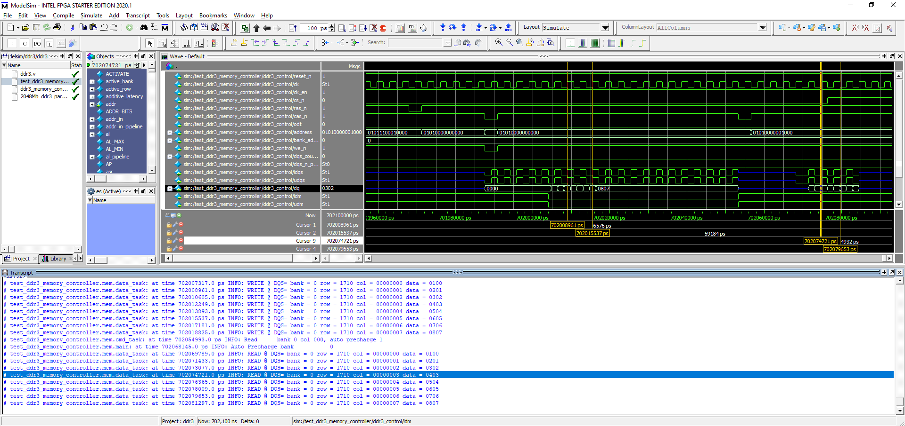

# DDR
A simple DDR3 memory controller for [Micron DDR3 RAM](https://www.micron.com/products/dram/ddr3-sdram/part-catalog/mt41j128m16jt-125)

Note:
1. This softcore IP had been verified (both functional and timing analysis) inside Xilinx IDE, and also being tested on Xilinx Spartan 6.
2. It can reach an optimum fmax of 333.333MHz without STA timing violations, without the need of any external SDC.

TODO:
1. Implement more functionalities since the current verilog code does not yet support Additive Latency (AL), write-leveling mode, self-refresh mode, inserting other DRAM commands within write or read bursts data operation for a smarter DRAM controller
2. Implement [Type-III digital PLL described in Floyd Gardner book: Phaselock Techniques, 3rd Edition](https://www.reddit.com/r/AskElectronics/comments/9i7g9j/loop_stability_of_type_3_digital_pll/) for high-speed application and `DQS` phase-shift purpose
3. Investigate high-speed DDR PHY IO as described in reference \[1\], [2], [3], [4], [5], [6]
4. Implement CMOS fractional-N PLL and phase shifter circuitry for the DRAM DDR
5. Design my own DDR3 FPGA board

Notes on Modelsim simulation for Micron DDR3 memory simulation model:
1. Creates a working directory named as `ddr3` and copies `ddr3_memory_controller.v`, `test_ddr3_memory_controller.v`, `2048Mb_ddr3_parameters.vh`, `ddr3.v`
2. Issues command : `vsim -gui work._2048Mb_ddr3_parameters_vh_unit work.ddr3 work.ddr3_memory_controller work.ddr3_memory_controller_v_unit work.test_ddr3_memory_controller`
3. Issues command : `source modelsim_wave.do` followed by `run 710us`
4. To restart simulation from timestep zero, just issue command : `restart`



Please find all the design files as well as IP cores, including the Vivado XSIM waveform database file .wdb and ddr3.vcd [here](https://1024terabox.com/s/1aePRXbFl9hoS76gIR8Qmig).

```
unzip -l DDR_Xilinx_Vivado_09_August_2026.zip | grep -E "wdb|vcd"
DDR_Xilinx_Vivado/DDR_Xilinx_Vivado.sim/sim_1/behav/xsim/test_ddr3_memory_controller_behav.wdb
DDR_Xilinx_Vivado/DDR_Xilinx_Vivado.sim/sim_1/behav/xsim/ddr3.vcd


test_ddr3_memory_controller.mem.file_io_open: at time                    0 WARNING: no +model_data option specified, using /tmp.
test_ddr3_memory_controller.mem.open_bank_file: at time 0 INFO: opening /tmp/test_ddr3_memory_controller.mem.open_bank_file.0.
test_ddr3_memory_controller.mem.open_bank_file: at time 0 INFO: opening /tmp/test_ddr3_memory_controller.mem.open_bank_file.1.
test_ddr3_memory_controller.mem.open_bank_file: at time 0 INFO: opening /tmp/test_ddr3_memory_controller.mem.open_bank_file.2.
test_ddr3_memory_controller.mem.open_bank_file: at time 0 INFO: opening /tmp/test_ddr3_memory_controller.mem.open_bank_file.3.
test_ddr3_memory_controller.mem.open_bank_file: at time 0 INFO: opening /tmp/test_ddr3_memory_controller.mem.open_bank_file.4.
test_ddr3_memory_controller.mem.open_bank_file: at time 0 INFO: opening /tmp/test_ddr3_memory_controller.mem.open_bank_file.5.
test_ddr3_memory_controller.mem.open_bank_file: at time 0 INFO: opening /tmp/test_ddr3_memory_controller.mem.open_bank_file.6.
test_ddr3_memory_controller.mem.open_bank_file: at time 0 INFO: opening /tmp/test_ddr3_memory_controller.mem.open_bank_file.7.
xsim: Time (s): cpu = 00:00:15 ; elapsed = 00:00:07 . Memory (MB): peak = 15551.410 ; gain = 0.000 ; free physical = 579 ; free virtual = 2267
INFO: [USF-XSim-96] XSim completed. Design snapshot 'test_ddr3_memory_controller_behav' loaded.
INFO: [USF-XSim-97] XSim simulation ran for 1000ns
launch_simulation: Time (s): cpu = 00:00:46 ; elapsed = 00:00:27 . Memory (MB): peak = 15551.410 ; gain = 0.000 ; free physical = 579 ; free virtual = 2267
run 750us
test_ddr3_memory_controller.mem.cmd_task: at time 735112871.0 ps INFO: Load Mode 2
test_ddr3_memory_controller.mem.cmd_task: at time 735112871.0 ps INFO: Load Mode 2 Partial Array Self Refresh = Bank 0-7
test_ddr3_memory_controller.mem.cmd_task: at time 735112871.0 ps INFO: Load Mode 2 CAS Write Latency =           5
test_ddr3_memory_controller.mem.cmd_task: at time 735112871.0 ps INFO: Load Mode 2 Auto Self Refresh = Disabled
test_ddr3_memory_controller.mem.cmd_task: at time 735112871.0 ps INFO: Load Mode 2 Self Refresh Temperature = Normal
test_ddr3_memory_controller.mem.cmd_task: at time 735112871.0 ps INFO: Load Mode 2 Dynamic ODT = Disabled
test_ddr3_memory_controller.mem.cmd_task: at time 735137060.0 ps INFO: Load Mode 3
test_ddr3_memory_controller.mem.cmd_task: at time 735137060.0 ps INFO: Load Mode 3 MultiPurpose Register Select = Pre-defined pattern
test_ddr3_memory_controller.mem.cmd_task: at time 735137060.0 ps INFO: Load Mode 3 MultiPurpose Register Enable = Disabled
test_ddr3_memory_controller.mem.cmd_task: at time 735161249.0 ps INFO: Load Mode 1
test_ddr3_memory_controller.mem.cmd_task: at time 735161249.0 ps INFO: Load Mode 1 DLL Enable = Enabled
test_ddr3_memory_controller.mem.cmd_task: at time 735161249.0 ps INFO: Load Mode 1 Output Drive Strength =          34 Ohm
test_ddr3_memory_controller.mem.cmd_task: at time 735161249.0 ps INFO: Load Mode 1 ODT Rtt = Disabled
test_ddr3_memory_controller.mem.cmd_task: at time 735161249.0 ps INFO: Load Mode 1 Additive Latency = 0
test_ddr3_memory_controller.mem.cmd_task: at time 735161249.0 ps INFO: Load Mode 1 Write Levelization = Disabled
test_ddr3_memory_controller.mem.cmd_task: at time 735161249.0 ps INFO: Load Mode 1 TDQS Enable = Disabled
test_ddr3_memory_controller.mem.cmd_task: at time 735161249.0 ps INFO: Load Mode 1 Qoff = Enabled
test_ddr3_memory_controller.mem.cmd_task: at time 735185438.0 ps INFO: Load Mode 0
test_ddr3_memory_controller.mem.cmd_task: at time 735185438.0 ps INFO: Load Mode 0 Burst Length =  8
test_ddr3_memory_controller.mem.cmd_task: at time 735185438.0 ps INFO: Load Mode 0 Burst Order = Sequential
test_ddr3_memory_controller.mem.cmd_task: at time 735185438.0 ps INFO: Load Mode 0 CAS Latency =           5
test_ddr3_memory_controller.mem.cmd_task: at time 735185438.0 ps INFO: Load Mode 0 DLL Reset = Reset DLL
test_ddr3_memory_controller.mem.cmd_task: at time 735185438.0 ps INFO: Load Mode 0 Write Recovery =           6
test_ddr3_memory_controller.mem.cmd_task: at time 735185438.0 ps INFO: Load Mode 0 Power Down Mode = DLL on
test_ddr3_memory_controller.mem.cmd_task: at time 735233816.0 ps INFO: ZQ        long = 1
test_ddr3_memory_controller.mem.cmd_task: at time 735233816.0 ps INFO: Initialization Sequence is complete
test_ddr3_memory_controller.mem.cmd_task: at time 736794005.0 ps INFO: Activate  bank 0 row 1510
Within ACTIVATE state, addr = 1510
test_ddr3_memory_controller.mem.cmd_task: at time 736818194.0 ps INFO: Write     bank 0 col 000, auto precharge 0
test_ddr3_memory_controller.mem.cmd_task: at time 736830288.0 ps INFO: Write     bank 0 col 008, auto precharge 0
before memory_read(bank, row, col, memory_data);, row = 1510
before read_from_file(), bank = 0, addr = 0a8800, row = = 1510, col = 000
Before code = $fseek( fd, offset, 0 ); ,fd = ffffb1e0, offset = 01510000
code = 00000000
test_ddr3_memory_controller.mem.data_task: at time 736834824.0 ps INFO: WRITE @ DQS= bank = 0 row = 1510 col = 00000000 data = 0005
test_ddr3_memory_controller.mem.data_task: at time 736836336.0 ps INFO: WRITE @ DQS= bank = 0 row = 1510 col = 00000001 data = 0006
test_ddr3_memory_controller.mem.data_task: at time 736837848.0 ps INFO: WRITE @ DQS= bank = 0 row = 1510 col = 00000002 data = 0007
test_ddr3_memory_controller.mem.data_task: at time 736839359.0 ps INFO: WRITE @ DQS= bank = 0 row = 1510 col = 00000003 data = 0008
test_ddr3_memory_controller.mem.data_task: at time 736840871.0 ps INFO: WRITE @ DQS= bank = 0 row = 1510 col = 00000004 data = 0009
test_ddr3_memory_controller.mem.data_task: at time 736842383.0 ps INFO: WRITE @ DQS= bank = 0 row = 1510 col = 00000005 data = 000a
test_ddr3_memory_controller.mem.cmd_task: at time 736842383.0 ps INFO: Write     bank 0 col 010, auto precharge 0
test_ddr3_memory_controller.mem.data_task: at time 736843895.0 ps INFO: WRITE @ DQS= bank = 0 row = 1510 col = 00000006 data = 000b
test_ddr3_memory_controller.mem.data_task: at time 736845407.0 ps INFO: WRITE @ DQS= bank = 0 row = 1510 col = 00000007 data = 000c
before memory_read(bank, row, col, memory_data);, row = 1510
before read_from_file(), bank = 0, addr = 0a8801, row = = 1510, col = 008
Before code = $fseek( fd, offset, 0 ); ,fd = ffffb1e0, offset = 01510020
code = 00000000
test_ddr3_memory_controller.mem.data_task: at time 736846918.0 ps INFO: WRITE @ DQS= bank = 0 row = 1510 col = 00000008 data = 000d
test_ddr3_memory_controller.mem.data_task: at time 736848430.0 ps INFO: WRITE @ DQS= bank = 0 row = 1510 col = 00000009 data = 000e
test_ddr3_memory_controller.mem.data_task: at time 736849942.0 ps INFO: WRITE @ DQS= bank = 0 row = 1510 col = 0000000a data = 000f
test_ddr3_memory_controller.mem.data_task: at time 736851454.0 ps INFO: WRITE @ DQS= bank = 0 row = 1510 col = 0000000b data = 0010
test_ddr3_memory_controller.mem.data_task: at time 736852966.0 ps INFO: WRITE @ DQS= bank = 0 row = 1510 col = 0000000c data = 0011
test_ddr3_memory_controller.mem.data_task: at time 736854477.0 ps INFO: WRITE @ DQS= bank = 0 row = 1510 col = 0000000d data = 0012
test_ddr3_memory_controller.mem.cmd_task: at time 736854477.0 ps INFO: Write     bank 0 col 018, auto precharge 0
test_ddr3_memory_controller.mem.data_task: at time 736855989.0 ps INFO: WRITE @ DQS= bank = 0 row = 1510 col = 0000000e data = 0013
test_ddr3_memory_controller.mem.data_task: at time 736857501.0 ps INFO: WRITE @ DQS= bank = 0 row = 1510 col = 0000000f data = 0014
before memory_read(bank, row, col, memory_data);, row = 1510
before read_from_file(), bank = 0, addr = 0a8802, row = = 1510, col = 010
Before code = $fseek( fd, offset, 0 ); ,fd = ffffb1e0, offset = 01510040
code = 00000000
test_ddr3_memory_controller.mem.data_task: at time 736859013.0 ps INFO: WRITE @ DQS= bank = 0 row = 1510 col = 00000010 data = 0015
test_ddr3_memory_controller.mem.data_task: at time 736860525.0 ps INFO: WRITE @ DQS= bank = 0 row = 1510 col = 00000011 data = 0016
test_ddr3_memory_controller.mem.data_task: at time 736862037.0 ps INFO: WRITE @ DQS= bank = 0 row = 1510 col = 00000012 data = 0017
test_ddr3_memory_controller.mem.data_task: at time 736863548.0 ps INFO: WRITE @ DQS= bank = 0 row = 1510 col = 00000013 data = 0018
test_ddr3_memory_controller.mem.data_task: at time 736865060.0 ps INFO: WRITE @ DQS= bank = 0 row = 1510 col = 00000014 data = 0019
test_ddr3_memory_controller.mem.data_task: at time 736866572.0 ps INFO: WRITE @ DQS= bank = 0 row = 1510 col = 00000015 data = 001a
test_ddr3_memory_controller.mem.data_task: at time 736868084.0 ps INFO: WRITE @ DQS= bank = 0 row = 1510 col = 00000016 data = 001b
test_ddr3_memory_controller.mem.data_task: at time 736869596.0 ps INFO: WRITE @ DQS= bank = 0 row = 1510 col = 00000017 data = 001c
before memory_read(bank, row, col, memory_data);, row = 1510
before read_from_file(), bank = 0, addr = 0a8803, row = = 1510, col = 018
Before code = $fseek( fd, offset, 0 ); ,fd = ffffb1e0, offset = 01510060
code = 00000000
test_ddr3_memory_controller.mem.data_task: at time 736871107.0 ps INFO: WRITE @ DQS= bank = 0 row = 1510 col = 00000018 data = 001d
test_ddr3_memory_controller.mem.data_task: at time 736872619.0 ps INFO: WRITE @ DQS= bank = 0 row = 1510 col = 00000019 data = 001e
test_ddr3_memory_controller.mem.data_task: at time 736874131.0 ps INFO: WRITE @ DQS= bank = 0 row = 1510 col = 0000001a data = 001f
test_ddr3_memory_controller.mem.data_task: at time 736875643.0 ps INFO: WRITE @ DQS= bank = 0 row = 1510 col = 0000001b data = 0020
test_ddr3_memory_controller.mem.data_task: at time 736877155.0 ps INFO: WRITE @ DQS= bank = 0 row = 1510 col = 0000001c data = 0021
test_ddr3_memory_controller.mem.data_task: at time 736878666.0 ps INFO: WRITE @ DQS= bank = 0 row = 1510 col = 0000001d data = 0022
test_ddr3_memory_controller.mem.data_task: at time 736880178.0 ps INFO: WRITE @ DQS= bank = 0 row = 1510 col = 0000001e data = 0023
test_ddr3_memory_controller.mem.data_task: at time 736881690.0 ps INFO: WRITE @ DQS= bank = 0 row = 1510 col = 0000001f data = 0024
test_ddr3_memory_controller.mem.cmd_task: at time 737132651.0 ps INFO: Read      bank 0 col 000, auto precharge 0
test_ddr3_memory_controller.mem.cmd_task: at time 737144745.0 ps INFO: Read      bank 0 col 008, auto precharge 0
before memory_read(bank, row, col, memory_data);, row = 1510
before read_from_file(), bank = 0, addr = 0a8800, row = = 1510, col = 000
Before code = $fseek( fd, offset, 0 ); ,fd = ffffb1e0, offset = 01510000
code = 00000000
test_ddr3_memory_controller.mem.data_task: at time 737146257.0 ps INFO: READ @ DQS= bank = 0 row = 1510 col = 00000000 data = 0005
test_ddr3_memory_controller.mem.data_task: at time 737147769.0 ps INFO: READ @ DQS= bank = 0 row = 1510 col = 00000001 data = 0006
test_ddr3_memory_controller.mem.data_task: at time 737149281.0 ps INFO: READ @ DQS= bank = 0 row = 1510 col = 00000002 data = 0007
test_ddr3_memory_controller.mem.data_task: at time 737150792.0 ps INFO: READ @ DQS= bank = 0 row = 1510 col = 00000003 data = 0008
test_ddr3_memory_controller.mem.data_task: at time 737152304.0 ps INFO: READ @ DQS= bank = 0 row = 1510 col = 00000004 data = 0009
test_ddr3_memory_controller.mem.data_task: at time 737153816.0 ps INFO: READ @ DQS= bank = 0 row = 1510 col = 00000005 data = 000a
test_ddr3_memory_controller.mem.data_task: at time 737155328.0 ps INFO: READ @ DQS= bank = 0 row = 1510 col = 00000006 data = 000b
test_ddr3_memory_controller.mem.data_task: at time 737156840.0 ps INFO: READ @ DQS= bank = 0 row = 1510 col = 00000007 data = 000c
test_ddr3_memory_controller.mem.cmd_task: at time 737156840.0 ps INFO: Read      bank 0 col 010, auto precharge 0
before memory_read(bank, row, col, memory_data);, row = 1510
before read_from_file(), bank = 0, addr = 0a8801, row = = 1510, col = 008
Before code = $fseek( fd, offset, 0 ); ,fd = ffffb1e0, offset = 01510020
code = 00000000
test_ddr3_memory_controller.mem.data_task: at time 737158351.0 ps INFO: READ @ DQS= bank = 0 row = 1510 col = 00000008 data = 000d
test_ddr3_memory_controller.mem.data_task: at time 737159863.0 ps INFO: READ @ DQS= bank = 0 row = 1510 col = 00000009 data = 000e
test_ddr3_memory_controller.mem.data_task: at time 737161375.0 ps INFO: READ @ DQS= bank = 0 row = 1510 col = 0000000a data = 000f
test_ddr3_memory_controller.mem.data_task: at time 737162887.0 ps INFO: READ @ DQS= bank = 0 row = 1510 col = 0000000b data = 0010
test_ddr3_memory_controller.mem.data_task: at time 737164399.0 ps INFO: READ @ DQS= bank = 0 row = 1510 col = 0000000c data = 0011
test_ddr3_memory_controller.mem.data_task: at time 737165911.0 ps INFO: READ @ DQS= bank = 0 row = 1510 col = 0000000d data = 0012
test_ddr3_memory_controller.mem.data_task: at time 737167422.0 ps INFO: READ @ DQS= bank = 0 row = 1510 col = 0000000e data = 0013
test_ddr3_memory_controller.mem.data_task: at time 737168934.0 ps INFO: READ @ DQS= bank = 0 row = 1510 col = 0000000f data = 0014
test_ddr3_memory_controller.mem.cmd_task: at time 737168934.0 ps INFO: Read      bank 0 col 018, auto precharge 0
before memory_read(bank, row, col, memory_data);, row = 1510
before read_from_file(), bank = 0, addr = 0a8802, row = = 1510, col = 010
Before code = $fseek( fd, offset, 0 ); ,fd = ffffb1e0, offset = 01510040
code = 00000000
test_ddr3_memory_controller.mem.data_task: at time 737170446.0 ps INFO: READ @ DQS= bank = 0 row = 1510 col = 00000010 data = 0015
test_ddr3_memory_controller.mem.data_task: at time 737171958.0 ps INFO: READ @ DQS= bank = 0 row = 1510 col = 00000011 data = 0016
test_ddr3_memory_controller.mem.data_task: at time 737173470.0 ps INFO: READ @ DQS= bank = 0 row = 1510 col = 00000012 data = 0017
test_ddr3_memory_controller.mem.data_task: at time 737174981.0 ps INFO: READ @ DQS= bank = 0 row = 1510 col = 00000013 data = 0018
test_ddr3_memory_controller.mem.data_task: at time 737176493.0 ps INFO: READ @ DQS= bank = 0 row = 1510 col = 00000014 data = 0019
test_ddr3_memory_controller.mem.data_task: at time 737178005.0 ps INFO: READ @ DQS= bank = 0 row = 1510 col = 00000015 data = 001a
test_ddr3_memory_controller.mem.data_task: at time 737179517.0 ps INFO: READ @ DQS= bank = 0 row = 1510 col = 00000016 data = 001b
test_ddr3_memory_controller.mem.data_task: at time 737181029.0 ps INFO: READ @ DQS= bank = 0 row = 1510 col = 00000017 data = 001c
before memory_read(bank, row, col, memory_data);, row = 1510
before read_from_file(), bank = 0, addr = 0a8803, row = = 1510, col = 018
Before code = $fseek( fd, offset, 0 ); ,fd = ffffb1e0, offset = 01510060
code = 00000000
test_ddr3_memory_controller.mem.data_task: at time 737182540.0 ps INFO: READ @ DQS= bank = 0 row = 1510 col = 00000018 data = 001d
test_ddr3_memory_controller.mem.data_task: at time 737184052.0 ps INFO: READ @ DQS= bank = 0 row = 1510 col = 00000019 data = 001e
test_ddr3_memory_controller.mem.data_task: at time 737185564.0 ps INFO: READ @ DQS= bank = 0 row = 1510 col = 0000001a data = 001f
test_ddr3_memory_controller.mem.data_task: at time 737187076.0 ps INFO: READ @ DQS= bank = 0 row = 1510 col = 0000001b data = 0020
test_ddr3_memory_controller.mem.data_task: at time 737188588.0 ps INFO: READ @ DQS= bank = 0 row = 1510 col = 0000001c data = 0021
test_ddr3_memory_controller.mem.data_task: at time 737190100.0 ps INFO: READ @ DQS= bank = 0 row = 1510 col = 0000001d data = 0022
test_ddr3_memory_controller.mem.data_task: at time 737191611.0 ps INFO: READ @ DQS= bank = 0 row = 1510 col = 0000001e data = 0023
test_ddr3_memory_controller.mem.data_task: at time 737193123.0 ps INFO: READ @ DQS= bank = 0 row = 1510 col = 0000001f data = 0024
test_ddr3_memory_controller.mem.cmd_task: at time 737229407.0 ps INFO: Precharge bank   0
test_ddr3_memory_controller.mem.cmd_task: at time 737253596.0 ps INFO: Refresh  
test_ddr3_memory_controller.mem.cmd_task: at time 737459202.0 ps INFO: Refresh  
test_ddr3_memory_controller.mem.cmd_task: at time 737664808.0 ps INFO: Refresh  
test_ddr3_memory_controller.mem.cmd_task: at time 737870414.0 ps INFO: Refresh  
test_ddr3_memory_controller.mem.cmd_task: at time 738076021.0 ps INFO: Refresh  
test_ddr3_memory_controller.mem.cmd_task: at time 738281627.0 ps INFO: Refresh  
test_ddr3_memory_controller.mem.cmd_task: at time 738487233.0 ps INFO: Refresh
```

Credit: [@Elphel](https://blog.elphel.com/2014/06/ddr3-memory-interface-on-xilinx-zynq-soc-free-software-compatible/), [@Morin](https://github.com/MartinGeisse), [@Greg](https://github.com/gregdavill/), [@BrianHG and @NorthGuy](https://www.eevblog.com/forum/fpga/ddr3-initialization-sequence-issue/) for their helpful technical help and explanation

Reference:

\[1]: [Preamble detection and postamble closure for a memory interface controller](https://patents.google.com/patent/US8023342)

\[2]: [Circuit design technique for DQS enable/disable calibration](https://patents.google.com/patent/US9158873)

\[3]: [Dqs generating circuit in a ddr memory device and method of generating the dqs](https://patents.google.com/patent/KR20050101864A/en)

\[4]: [DQS strobe centering (data eye training) method](https://patents.google.com/patent/US7443741B2/en)

\[5]: [Data strobe enable circuitry](https://patents.google.com/patent/US9001595)

\[6]: [Bimodal serial to parallel converter with bitslip controller](https://patents.google.com/patent/US6985096)
